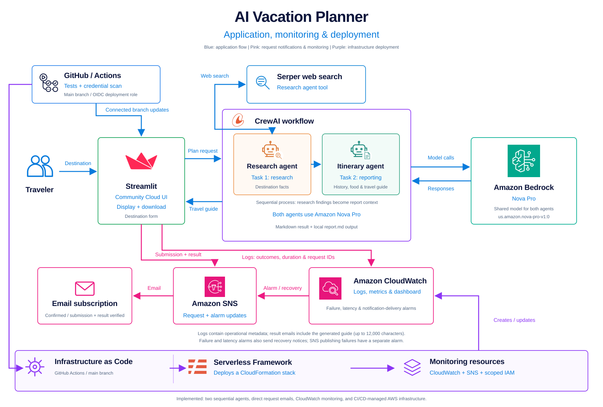

# AI Vacation Planner

[](https://github.com/rohitjain2021/vacation-planner/actions/workflows/ci.yml)

A simple travel-planning app built with **Streamlit**, **CrewAI**, and **Amazon Bedrock Nova Pro**. Enter a city or country to research places to visit, local food, and destination history, then turn those findings into a downloadable travel guide.

## Live demo

**[Open the Personal Vacation Planner](https://personal-vacation-planner.streamlit.app/)**

## 1. What the app does

- Accepts a city or country through a simple Streamlit interface.
- Researches the destination using a CrewAI agent with Serper web search.
- Produces research findings covering attractions and interesting destination facts.
- Uses a second agent to create a Markdown guide covering places to explore, history, and local food.
- Keeps the generated plan visible during the current Streamlit session.
- Lets users download their plan as a Markdown file.
- Also supports a command-line run through the same CrewAI workflow.

## 2. Architecture



[Open the full-size architecture diagram](./architecture.svg).

The diagram represents the components implemented in this repository. The Python application runs locally or on a Streamlit host; Amazon Bedrock and Serper are external services called by that application.

### How the parts connect

1. **Destination input:** The traveler enters a city or country and selects **Plan my trip**. Streamlit rejects blank input before starting the crew.
2. **Crew orchestration:** The UI calls `VacationPlanner().crew().kickoff()` with the destination and current year. CrewAI runs the tasks sequentially.
3. **Research:** The vacation researcher uses `SerperDevTool` to search the web. Its task requests 15 destination facts.
4. **Itinerary planning:** The itinerary planner reviews the research findings and generates a detailed Markdown report. Its role covers tourist spots, destination history, and local foods.
5. **Shared language model:** Both agents use Amazon Nova Pro through Amazon Bedrock, configured as `bedrock/us.amazon.nova-pro-v1:0`.
6. **Results:** The crew returns its generated text to Streamlit for display and download. Session state retains the last completed plan across normal app reruns.
7. **File output:** The reporting task also writes `report.md` to the application's host filesystem. The UI displays the returned crew result rather than rereading an older report file.

The dashed diagram connection shows the alternative CLI entry point. YAML files define the agents and tasks. Credentials are supplied separately through local or hosted environment configuration.

## 3. Technology stack

| Component | Purpose |
| --- | --- |
| Streamlit | Destination form, result display, session state, and Markdown download |
| CrewAI | Two-agent workflow with sequential research and reporting tasks |
| SerperDevTool | Web search available to the research agent |
| Amazon Bedrock / Nova Pro | Language model used by both agents |
| python-dotenv | Loads the project's ignored local `.env` file |
| uv | Dependency installation and lockfile management |

## 4. Run locally

Use **Python 3.10-3.13**, Git, and uv. Python 3.13 is a suitable choice for this project. You also need a Serper API key and AWS credentials with permission to invoke the configured Bedrock model and inference profile.

### Clone and install

```powershell
git clone https://github.com/rohitjain2021/vacation-planner.git
cd vacation-planner/vacation_planner
uv sync --python 3.13
```

### Configure credentials locally

Create the local environment file once, preserving it if it already exists:

```powershell
if (!(Test-Path .env)) { Copy-Item .env.example .env }
```

Edit `.env` locally and supply the values your account requires:

| Variable | Purpose |
| --- | --- |
| `SERPER_API_KEY` | Authenticates destination web searches |
| `AWS_DEFAULT_REGION` | AWS source region; the template uses `us-east-1` |
| `AWS_ACCESS_KEY_ID` / `AWS_SECRET_ACCESS_KEY` | AWS credentials when using environment-based authentication |
| `AWS_SESSION_TOKEN` | Required when using temporary AWS credentials |
| `CREWAI_TRACING_ENABLED` | CrewAI tracing setting included in the template |

AWS authentication can also come from the standard AWS credential chain, such as a configured local profile or an execution role. Keep real values out of Python files, YAML, documentation, and Git commits. For a hosted app, supply credentials through the hosting platform's secret configuration.

The Nova Pro model is explicitly selected in `src/vacation_planner/crew.py`. Changing `MODEL` in `.env` alone does not change those explicit agent model settings.

### Start the web app

```powershell
uv run streamlit run streamlitui.py
```

Open **http://localhost:8501/**, enter a destination, and select **Plan my trip**. Stop the local server with `Ctrl+C`.

For a GitHub-connected Streamlit deployment, the app entry point relative to the repository root is:

```text
vacation_planner/streamlitui.py
```

## 5. Run from the command line

From the `vacation_planner` project directory:

```powershell
uv run vacation_planner
```

This invokes `run()` in `src/vacation_planner/main.py`, which currently uses **London** as the destination. Change its `topic` input to run another destination. The reporting task writes `report.md` in the working directory.

See the [CrewAI and Bedrock setup guide](./CREWAI_INSTALLATION.md) for additional setup details.

## 6. Repository layout

```text
vacation-planner/
|-- README.md
|-- architecture.svg
|-- CREWAI_INSTALLATION.md
`-- vacation_planner/
    |-- streamlitui.py
    |-- .streamlit/config.toml
    |-- .env.example
    |-- pyproject.toml
    |-- uv.lock
    `-- src/vacation_planner/
        |-- main.py
        |-- crew.py
        `-- config/
            |-- agents.yaml
            `-- tasks.yaml
```

## 7. Practical notes

- **Suggestions, not reservations:** The app researches and generates travel ideas; it does not book flights, hotels, or activities.
- **Check current details:** AI-generated suggestions can be inaccurate. Confirm prices, opening hours, availability, and travel requirements independently.
- **Service usage:** Generating a plan calls Serper and Amazon Bedrock and can incur usage charges.
- **Session storage:** The last plan is retained in Streamlit session state, not a persistent trip database. Download it to keep a copy.
- **Generated files:** `.env`, generated reports, and local environment files are excluded from Git. On a hosted instance, `report.md` is a local runtime file and may be overwritten by another run.

## 8. GitHub Actions pipeline

[Vacation Planner CI](https://github.com/rohitjain2021/vacation-planner/actions/workflows/ci.yml) runs on pushes to `main`, pull requests, and manual requests from the Actions tab.

- **Python checks:** Install the locked dependencies with Python 3.13, compile the application and tests, and run the Streamlit and credential-exclusion tests.
- **Credential scan:** Run a checksum-verified, pinned Gitleaks release across Git history with secret values redacted. Two reviewed historical false positives in blank configuration/documentation are ignored by exact fingerprint, not by excluding entire files.
- **No provider keys:** Tests replace the CrewAI entry point with a mock. The workflow does not receive AWS or Serper secrets and does not make paid model or search calls.

Run the application tests locally from `vacation_planner/`:

```powershell
uv run --frozen python -m unittest discover -s ../tests -v
```

Streamlit Community Cloud continues updating from its configured GitHub branch. This workflow checks changes; it does not gate direct pushes or change deployment settings. To require passing checks before a merge, configure a branch rule for `main` requiring **Python checks** and **Credential scan**.
